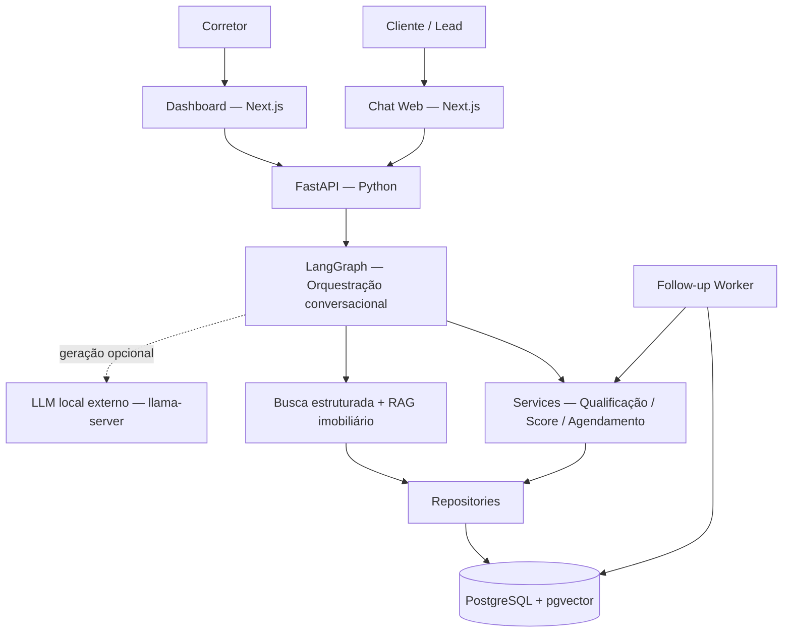

# 🏠 Hackathon FIAP — LIA: Agente SDR Imobiliário com Inteligência Artificial

**Pós-graduação em Inteligência Artificial para Desenvolvedores — FIAP**

A **LIA** é uma prova de conceito (POC) de agente SDR (*Sales Development Representative*) imobiliário que automatiza o atendimento inicial, qualifica oportunidades comerciais, busca imóveis, auxilia no agendamento de visitas ou reuniões e disponibiliza informações estruturadas para o corretor.

> ⚠️ **Aviso importante:** esta é uma solução acadêmica demonstrativa, não um CRM de produção. A pontuação comercial é calculada por regras determinísticas; respostas produzidas por modelos de linguagem devem ser avaliadas no contexto de uso. Não há envio automático por WhatsApp ou e-mail.

## 📋 Sumário

- [🏠 Sobre o projeto](#-sobre-o-projeto)
- [✨ Funcionalidades](#-funcionalidades)
- [🏗️ Arquitetura](#️-arquitetura)
- [🔄 Fluxo de atendimento](#-fluxo-de-atendimento)
- [🧠 Inteligência artificial e modelos](#-inteligência-artificial-e-modelos)
- [📁 Estrutura do repositório](#-estrutura-do-repositório)
- [▶️ Como executar](#️-como-executar)
- [🛠️ Tecnologias](#️-tecnologias)
- [📊 Resultados e testes](#-resultados-e-testes)
- [🎥 Vídeo de demonstração](#-vídeo-de-demonstração)
- [📄 Documentação técnica](#-documentação-técnica)
- [⚠️ Limitações](#️-limitações)
- [👥 Equipe](#-equipe)
- [📜 Licença e finalidade](#-licença-e-finalidade)

## 🏠 Sobre o projeto

O atendimento comercial imobiliário exige compreender necessidades do cliente, identificar oportunidades e registrar informações para continuidade do trabalho do corretor. A **LIA** reúne essas etapas em uma aplicação web com recursos de inteligência artificial e regras de negócio auditáveis.

**Principais objetivos:**

- 💬 Atender o cliente por um chat web com histórico persistente.
- 🎯 Identificar intenção de **compra, aluguel ou investimento** e preferências imobiliárias.
- 📈 Qualificar o lead e calcular um **Lead Score determinístico**.
- 🔎 Buscar imóveis reais da base usando filtros e recuperação semântica.
- 📅 Apoiar o agendamento de **visita ou reunião** e preparar o *handoff* para o corretor.
- 📊 Disponibilizar um dashboard de acompanhamento dos leads.
- 🔔 Executar follow-up automático no **Chat WEB** após agendamento pela API.

## ✨ Funcionalidades

| Módulo | O que faz |
|---|---|
| Atendimento inteligente | Conversa com o lead, preserva contexto e coleta preferências |
| Qualificação comercial | Identifica intenção, região, orçamento, características e urgência |
| Lead Score | Pontuação e classificação **FRIO / MORNO / QUENTE** por regras determinísticas |
| Busca imobiliária | Consultas estruturadas, semânticas e híbridas |
| Agendamento e handoff | Registra visita/reunião e consolida dados para o corretor |
| Dashboard | Consulta leads, histórico, preferências e agendamentos; **somente leitura** |
| Follow-up automático | Worker envia mensagem na conversa WEB no horário programado |
| Resposta com LLM | Integração **opcional** a modelo local; fallback determinístico quando indisponível |

## 🏗️ Arquitetura



O frontend apresenta o Chat e o Dashboard. A API FastAPI coordena os casos de uso; o LangGraph organiza o fluxo conversacional; serviços implementam as regras de negócio; e os repositórios persistem os dados no PostgreSQL. O worker executa o follow-up de forma independente.

**Decisão arquitetural:** o LLM **não** calcula o Lead Score, não substitui validações comerciais e não é responsável pela persistência ou pela decisão final de agendamento.

## 🔄 Fluxo de atendimento

```text
Cliente inicia conversa
         │
         ▼
Identificação da intenção e preferências
         │
         ▼
Qualificação comercial + Lead Score
         │
         ▼
Busca estruturada e semântica de imóveis
         │
         ▼
Apresentação de cards e seleção do imóvel
         │
         ▼
Agendamento de visita/reunião + Handoff
         │
         ▼
Dashboard para acompanhamento do corretor
         │
         ▼
Follow-up agendado via API Swagger
         │
         ▼
Worker processa no horário programado
         │
         ▼
Mensagem automática aparece no Chat WEB
```

## 🧠 Inteligência artificial e modelos

| Componente | Papel na solução |
|---|---|
| **LangGraph** | Orquestra o estado e as etapas do atendimento |
| **LLM local (opcional)** | Gera respostas em linguagem natural por servidor compatível com API OpenAI |
| **Fallback determinístico** | Mantém o atendimento funcional sem o modelo de linguagem |
| **RAG imobiliário** | Recupera imóveis cadastrados para contextualizar as respostas |
| **Embeddings** | Representa características dos imóveis para recuperação por significado |
| **sentence-transformers** | Gera embeddings com `intfloat/multilingual-e5-small` |
| **PostgreSQL + pgvector** | Armazena imóveis e vetores e permite consultas híbridas |
| **Lead Score determinístico** | Classifica oportunidades sem delegar o cálculo ao LLM |

A implementação de RAG utiliza **registros de imóveis vetorizados**, e não uma base genérica de documentos ou FAQs.

## 📁 Estrutura do repositório

```text
fiap-sdr-imobiliario/
├── backend/               # API FastAPI, agente, serviços, migrations e testes
│   ├── app/
│   ├── alembic/
│   ├── scripts/
│   └── tests/
├── frontend/              # Chat, Dashboard e testes do Next.js
├── data/
│   └── raw/               # Dataset de imóveis de Curitiba
├── docs/                  # Arquitetura, requisitos e rastreabilidade
│   ├── ARCHITECTURE.md
│   ├── REQUIREMENTS.md
│   ├── TRACEABILITY.md
│   └── CONVENTIONS.md
├── video/                 # Vídeo de demonstração
├── .env.example
├── compose.yaml
└── README.md
```

> O vídeo local deve passar por auditoria visual de privacidade antes de ser publicado ou enviado para hospedagem externa.

## ▶️ Como executar

### Pré-requisitos

- Git
- Docker Desktop com Docker Compose v2
- Acesso à internet no primeiro download do modelo de embeddings
- Opcional: servidor local `llama-server` para geração de respostas por LLM

### 1. Clonar o repositório

```bash
git clone https://github.com/AlmeidaLima/fiap-sdr-imobiliario.git
cd fiap-sdr-imobiliario
```

### 2. Configurar variáveis de ambiente

**Windows PowerShell:**

```powershell
Copy-Item .env.example .env
```

**Linux/macOS:**

```bash
cp .env.example .env
```

Revise os valores locais do `.env`. **Não publique credenciais reais no Git.**

### 3. Preparar banco, schema e imóveis

Execute os comandos abaixo **na raiz do repositório**, em um ambiente novo:

```bash
# Iniciar PostgreSQL
docker compose up -d postgres

# Verificar se o banco aceita conexões
docker compose exec postgres sh -c 'pg_isready -U "$POSTGRES_USER" -d "$POSTGRES_DB"'

# Aplicar migrations
docker compose run --rm backend alembic upgrade head

# Importar imóveis
docker compose run --rm backend python -m scripts.import_curitiba_properties

# Gerar embeddings
docker compose run --rm backend python -m scripts.index_property_embeddings --batch-size 100
```

> Aguarde o `pg_isready` indicar que o PostgreSQL aceita conexões antes de aplicar as migrations. O primeiro download do modelo de embeddings pode demorar. A execução em containers diferentes pode exigir downloads adicionais devido ao cache não compartilhado.

### 4. Iniciar a aplicação

```bash
docker compose up --build -d
docker compose ps
```

| Interface | Endereço padrão |
|---|---|
| 💬 Chat | http://localhost:3000 |
| 📊 Dashboard | http://localhost:3000/dashboard |
| 📘 Swagger | http://localhost:8000/docs |
| ❤️ Health | http://localhost:8000/api/v1/health |

### 5. Opcional: habilitar LLM local

O Compose **não** inicia o servidor de LLM. Com um `llama-server` externo ativo, configure no `.env`:

```dotenv
LLM_BASE_URL=http://host.docker.internal:8080
LLM_MODEL=local-model
LLM_TIMEOUT=30
```

O nome em `LLM_MODEL` precisa corresponder ao modelo exposto pelo servidor. Sem LLM, o sistema utiliza respostas determinísticas.

### 6. Executar testes

```bash
# Backend
docker compose exec backend python -m pytest -v

# Frontend
docker compose exec frontend npm run test:run
docker compose exec frontend npm run lint
docker compose run --rm frontend npm run build
```

### 7. Acompanhar logs e encerrar

```bash
docker compose logs -f backend
docker compose logs -f follow-up-worker

# Interrompe os containers sem apagar os volumes
docker compose down
```

> ⚠️ Evite `docker compose down -v` em ambientes com dados que deseja preservar: esse comando pode remover volumes do PostgreSQL.

## 🛠️ Tecnologias

| Camada | Ferramentas |
|---|---|
| Frontend | Next.js 16, React 19, TypeScript, Tailwind CSS |
| Backend | Python 3.12, FastAPI, SQLAlchemy, Alembic |
| Agente de IA | LangGraph |
| Geração de linguagem | LLM local opcional via llama.cpp / llama-server |
| Recuperação de imóveis | RAG, sentence-transformers, embeddings |
| Banco de dados | PostgreSQL 16, pgvector |
| Infraestrutura | Docker, Docker Compose |
| Qualidade | Pytest, Vitest, lint e build do frontend |

## 📊 Resultados e testes

A solução demonstra o ciclo comercial completo da POC: atendimento, qualificação, recuperação de imóveis, agendamento, handoff, consulta ao dashboard e envio automático de follow-up no Chat WEB.

**Saídas disponíveis:**

- Histórico persistido de mensagens e estado do atendimento.
- Score e classificação comercial do lead.
- Cards de imóveis compatíveis com os filtros informados.
- Registro de visita ou reunião e dados de handoff.
- Lista e detalhe de leads no dashboard.
- Status de follow-up (`PENDING`, `COMPLETED` ou `CANCELLED`) e tentativas de entrega.

**Como funciona o follow-up:** a criação é feita por `POST /api/v1/follow-ups` (Swagger/API); um worker verifica itens pendentes aproximadamente a cada **30 segundos**. No horário programado, registra a mensagem no histórico do Chat WEB. A interface consulta novas mensagens aproximadamente a cada **3 segundos**. O processo pode ser consultado por `GET /api/v1/follow-ups/{follow_up_id}`.

Os comandos da seção anterior permitem reproduzir os testes. Os números finais de testes aprovados devem ser registrados conforme a última execução validada antes da entrega.

## 🎥 Vídeo de demonstração

A apresentação da LIA demonstra:

1. **Abertura:** objetivo da solução.
2. **Tecnologias e arquitetura:** FastAPI, Next.js, LangGraph, LLM, RAG, pgvector e Lead Score.
3. **Etapa 1:** atendimento inteligente.
4. **Etapa 2:** qualificação comercial.
5. **Etapa 3:** busca de imóveis, agendamento e handoff.
6. **Etapa 4:** dashboard, agendamento do follow-up pelo Swagger e **mensagem automática aparecendo no Chat**.

**Vídeo local:** [LIA — Hackathon FIAP — Apresentação](video/LIA_Hackathon_FIAP_Apresentacao.mp4).

> A publicação deste vídeo depende da aprovação da auditoria visual de privacidade. Após a aprovação, ele poderá permanecer no repositório ou ser hospedado externamente, respeitando os limites do GitHub e as orientações da FIAP.

## 📄 Documentação técnica

- [Arquitetura](docs/ARCHITECTURE.md)
- [Requisitos](docs/REQUIREMENTS.md)
- [Rastreabilidade entre requisitos e testes](docs/TRACEABILITY.md)
- [Convenções](docs/CONVENTIONS.md)
- [Documentação do frontend](frontend/README.md)

- [Relatório técnico da LIA — Hackathon FIAP](docs/relatorio_tecnico_lia_hackathon_fiap.pdf)

**Dataset:** `data/raw/curitiba_apartment_real_estate_data.csv`, identificado como *Curitiba Apartment Real Estate Data*, derivado de *Curitiba Apartment Prices*, publicado por **wittmannf** no Kaggle. Seu uso é acadêmico; devem ser respeitados os termos de licença e atribuição da fonte.

## ⚠️ Limitações

- O follow-up automático é entregue **somente pelo Chat WEB**; não há integração implementada com WhatsApp ou e-mail.
- O dashboard é **somente leitura** e não oferece edição de leads.
- O LLM é **opcional e externo** ao Docker Compose.
- O RAG recupera imóveis cadastrados, não uma base documental genérica.
- O fluxo de agendamento implementa **visita** e **reunião**.
- Não há autenticação, CRM completo ou infraestrutura de produção.

## 👥 Equipe

| Integrante | RM |
|---|---|
| **[Nome do integrante 1]** | **[RM]** |
| **[Nome do integrante 2]** | **[RM]** |
| **[Nome do integrante 3]** | **[RM]** |

> Substituir os campos acima pelos integrantes e respectivos RMs antes da entrega.

## 📜 Licença e finalidade

Projeto acadêmico desenvolvido para fins educacionais no **Hackathon da Pós-Graduação em Inteligência Artificial para Desenvolvedores da FIAP**.

A licença de uso do código deve ser definida no arquivo `LICENSE`, caso a equipe opte por publicar o projeto sob uma licença específica. O dataset de terceiros permanece sujeito às condições de sua fonte original.
