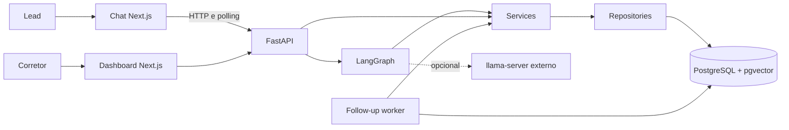

# Agente SDR Imobiliário com IA

POC desenvolvida para o Hackathon da Pós-Graduação FIAP — IA para Devs. O sistema representa um atendimento comercial imobiliário assistido por IA: conversa com o lead, mantém contexto, qualifica a oportunidade, calcula um score determinístico, consulta imóveis reais, conduz seleção e agendamento, gera handoff para o corretor e permite acompanhamento por dashboard.

Esta é uma POC acadêmica, não um CRM ou uma plataforma imobiliária de produção.

## Funcionalidades implementadas

- Chat web persistente com histórico e polling incremental.
- Orquestração conversacional com LangGraph.
- Identificação do lead, intenção comercial e preferências.
- Qualificação progressiva e Lead Score determinístico (`FRIO`, `MORNO`, `QUENTE`).
- Busca estruturada, semântica e híbrida de imóveis persistidos.
- Seleção de imóvel, agendamento de visita ou reunião e handoff estruturado.
- Dashboard somente leitura com lista e detalhe dos leads.
- Follow-up automático pelo canal interno `WEB`, processado por worker separado.
- LLM local externo compatível com a API OpenAI e fallback determinístico.
- PostgreSQL, pgvector, migrations Alembic e importação reproduzível do dataset.
- Observabilidade básica com request ID e logs estruturados seguros.

## Tecnologias

| Área | Tecnologias |
|---|---|
| Frontend | Next.js 16, React 19, TypeScript, Tailwind CSS, Vitest |
| Backend | Python 3.12, FastAPI, SQLAlchemy, Alembic, Pytest |
| IA | LangGraph, llama.cpp/llama-server opcional, sentence-transformers |
| Dados | PostgreSQL 16, pgvector |
| Infraestrutura | Docker e Docker Compose |

## Arquitetura resumida



As rotas HTTP coordenam casos de uso por services, e repositories concentram o acesso ao banco. Regras comerciais críticas, como Lead Score, validações, estados e persistência, não são delegadas ao LLM. Consulte [docs/ARCHITECTURE.md](docs/ARCHITECTURE.md) para detalhes e [docs/TRACEABILITY.md](docs/TRACEABILITY.md) para a relação entre requisitos, código e testes.

## Pré-requisitos

- Git.
- Docker Desktop com Docker Compose v2.
- Rede, espaço em disco e tempo adicional no primeiro uso do modelo de embeddings em cada ambiente ou container que ainda não possua cache.
- Opcional: `llama-server` executando no host para respostas geradas por LLM.

Os comandos abaixo partem da raiz do repositório. Portas e credenciais locais de desenvolvimento vêm do arquivo `.env` e podem ser ajustadas antes da inicialização.

## Configuração do ambiente

### Linux/macOS

```bash
git clone <URL_DO_REPOSITORIO>
cd fiap-sdr-imobiliario
cp .env.example .env
```

### Windows PowerShell

```powershell
git clone <URL_DO_REPOSITORIO>
Set-Location fiap-sdr-imobiliario
Copy-Item .env.example .env
```

O `.env.example` contém apenas valores locais de desenvolvimento. Não versione o `.env` nem substitua seus valores por credenciais reais no repositório.

## Inicialização segura com Docker Compose

O worker consulta tabelas da aplicação. Em um clone limpo, aplique as migrations antes de subir o conjunto completo:

```bash
# 1. Inicie somente o PostgreSQL
docker compose up -d postgres

# 2. Confirme que o PostgreSQL já aceita conexões
docker compose exec postgres sh -c 'pg_isready -U "$POSTGRES_USER" -d "$POSTGRES_DB"'

# 3. Aplique o schema
docker compose run --rm backend alembic upgrade head

# 4. Importe os imóveis
docker compose run --rm backend python -m scripts.import_curitiba_properties

# 5. Gere os embeddings
docker compose run --rm backend python -m scripts.index_property_embeddings --batch-size 100

# 6. Suba backend, worker e frontend
docker compose up --build -d

# 7. Verifique os serviços
docker compose ps
```

Só prossiga para o Alembic quando `pg_isready` informar que o servidor está aceitando conexões; se ainda não estiver, aguarde e execute a verificação novamente.

O modelo `intfloat/multilingual-e5-small` não está incorporado à imagem Docker, e o Compose atual não configura um volume compartilhado para o cache do Hugging Face. Assim, o container efêmero usado na indexação pode baixar o modelo, e o backend pode precisar baixá-lo novamente em seu próprio container quando realizar a primeira busca que utilize embeddings. Cada primeiro uso sem cache disponível pode exigir rede, espaço em disco e tempo adicional. O comportamento exato depende do cache presente em cada ambiente ou container.

Execuções posteriores do indexador processam apenas imóveis disponíveis que ainda não possuem embedding, embora a inicialização do modelo continue sujeita ao cache disponível naquele container.

Depois da preparação inicial, o comando usual é:

```bash
docker compose up --build -d
```

## Migrations

```bash
docker compose run --rm backend alembic heads
docker compose run --rm backend alembic current
docker compose run --rm backend alembic upgrade head
```

O projeto deve possuir um único head. Não altere o schema manualmente: Alembic é o mecanismo oficial de evolução do banco.

## Importação de imóveis

O arquivo versionado é `data/raw/curitiba_apartment_real_estate_data.csv`. A importação lê, limpa, normaliza, valida e persiste os registros no PostgreSQL:

```bash
docker compose run --rm backend python -m scripts.import_curitiba_properties
```

O script usa uma chave externa determinística e pode ser executado novamente sem criar duplicatas para os mesmos registros. Linhas inválidas são contabilizadas pelo processo.

## Geração de embeddings

```bash
docker compose run --rm backend python -m scripts.index_property_embeddings --batch-size 100
```

Opções disponíveis:

```bash
docker compose run --rm backend python -m scripts.index_property_embeddings --help
```

Os documentos vetoriais são projeções dos próprios imóveis, não um acervo genérico de FAQs ou documentos fragmentados em chunks. A busca híbrida combina filtros estruturados e similaridade em pgvector.

## LLM local e fallback determinístico

O Compose não inicia um servidor de LLM. Quando desejado, execute no host um `llama-server` compatível com a API OpenAI e configure:

```dotenv
LLM_BASE_URL=http://host.docker.internal:8080
LLM_MODEL=local-model
LLM_TIMEOUT=30
```

O alias em `LLM_MODEL` deve corresponder ao modelo exposto pelo servidor. Sem LLM, com timeout ou indisponibilidade, o atendimento continua pelo fallback determinístico. Qualificação, score, busca, seleção, agendamento e follow-up não dependem de o LLM estar disponível.

## Interfaces e endpoints

Com os valores padrão de `.env.example`:

| Recurso | URL |
|---|---|
| Chat | <http://localhost:3000/> |
| Dashboard | <http://localhost:3000/dashboard> |
| Swagger | <http://localhost:8000/docs> |
| Health | <http://localhost:8000/api/v1/health> |
| Informações da API | <http://localhost:8000/api/v1/info> |

Endpoints principais:

| Método e caminho | Finalidade |
|---|---|
| `POST /api/v1/conversations/turn` | Processa um turno conversacional |
| `GET /api/v1/conversations/{conversation_id}/messages` | Histórico público e polling por `after_id` |
| `GET /api/v1/properties` | Busca estruturada |
| `GET /api/v1/properties/semantic-search` | Busca semântica |
| `GET /api/v1/properties/hybrid-search` | Busca híbrida |
| `POST /api/v1/properties/natural-language-search` | Interpreta busca em linguagem natural |
| `POST /api/v1/appointments` | Cria agendamento a partir da conversa |
| `GET /api/v1/appointments/{appointment_id}` | Consulta agendamento |
| `GET /api/v1/handoffs/{conversation_id}` | Projeção de handoff para o corretor |
| `GET /api/v1/dashboard/leads` | Lista leads no dashboard |
| `GET /api/v1/dashboard/leads/{lead_id}` | Detalha um lead |
| `POST /api/v1/follow-ups` | Agenda follow-up futuro |
| `GET /api/v1/follow-ups/{follow_up_id}` | Consulta follow-up |
| `POST /api/v1/follow-ups/{follow_up_id}/cancel` | Cancela follow-up pendente |
| `POST /api/v1/follow-ups/{follow_up_id}/attempts` | Registra tentativa manual/integrada |

### Dashboard

O dashboard é uma projeção somente leitura. A lista mostra nome, status persistido, intenção, score, classificação e última interação. O detalhe reúne preferências, histórico público, imóveis apresentados, imóvel selecionado, agendamentos e handoff. Não há edição de leads nem seção de follow-up.

### Follow-up automático WEB

O serviço `follow-up-worker` executa um ciclo imediato e repete a verificação a cada 30 segundos. Follow-ups `PENDING` vencidos são adquiridos em lotes determinísticos com `FOR UPDATE SKIP LOCKED`. Para cada entrega bem-sucedida, uma única transação persiste:

- uma `Message` com role `assistant` na conversa mais recente do lead;
- uma tentativa `WEB/SUCCESS`;
- o incremento de `attempt_count`;
- o status `COMPLETED` e `completed_at`.

O Chat consulta mensagens novas a cada 3 segundos, deduplica por ID e apresenta a mensagem automaticamente. `CANCELLED` e `COMPLETED` não são processados. Uma falha técnica causa rollback integral; o item permanece `PENDING` e pode ser reavaliado no ciclo seguinte.

Registros `LeadFollowUpAttempt` podem ter status `SUCCESS` ou `FAILED`. No fluxo automático, o worker só cria a tentativa `WEB/SUCCESS` quando a entrega é concluída: mensagem, tentativa, incremento de `attempt_count` e transição para `COMPLETED` são confirmados atomicamente no mesmo commit. Se ocorrer uma falha técnica antes desse commit, toda a transação é revertida, nenhuma tentativa `FAILED` é criada automaticamente e o follow-up permanece elegível para nova avaliação em um ciclo posterior. Portanto, `FAILED` não representa automaticamente toda falha técnica do worker; esse status pode ser registrado pelos fluxos explícitos suportados pela API.

`Lead.status` e `LeadFollowUp.status` têm significados distintos. `COMPLETED` indica apenas a conclusão daquele follow-up e não equivale a lead `ENCERRADO`. A máquina comercial `NOVO`/`EM_ATENDIMENTO`/`AGUARDANDO_RESPOSTA`/`FOLLOWUP_1`/`FOLLOWUP_2`/`ENCERRADO` não foi implementada. Não há entrega por WhatsApp ou e-mail.

## Testes e validações

Com o ambiente em execução:

```bash
# Backend
docker compose exec backend python -m pytest -v

# Frontend
docker compose exec frontend npm run test:run
docker compose exec frontend npm run lint
docker compose run --rm frontend npm run build
```

Alternativamente, para desenvolvimento local, instale as dependências de cada diretório e execute:

```bash
cd backend
python -m pytest -v
```

```bash
cd frontend
npm ci
npm run test:run
npm run lint
npm run build
```

Os testes de integração do backend requerem PostgreSQL compatível com o projeto.

## Observabilidade

Toda resposta HTTP recebe `X-Request-ID`. Um UUID externo válido é canonicalizado; quando ausente ou inválido, a aplicação gera um UUID v4. O ID é propagado por `request.state` e `ContextVar` aos eventos internos da requisição.

Os logs usam texto estruturado `key=value`, allowlist de campos e sanitização contra caracteres de controle. Eventos relevantes incluem:

- `request_completed` e `request_failed`;
- início e conclusão de turno conversacional;
- conclusão de chamada ao LLM e ativação do fallback;
- início, conclusão e falha da busca de imóveis;
- ciclo, entrega, falha e encerramento do worker.

Bodies, query strings, headers, prompts, conteúdo de mensagens, estado conversacional, embeddings, parâmetros SQL, traceback bruto e credenciais não são registrados pelos eventos da aplicação.

```bash
docker compose logs -f backend
docker compose logs -f follow-up-worker
```

Não há Prometheus, Grafana, Sentry, OpenTelemetry ou tracing distribuído nesta POC.

## Roteiro de demonstração

Pré-condições: migrations aplicadas, imóveis importados, embeddings gerados e todos os serviços saudáveis. O LLM local é opcional.

1. Abra o Chat e envie uma mensagem com nome e intenção de compra ou aluguel.
2. Responda às perguntas de região, orçamento e quartos; observe qualificação e Lead Score.
3. Solicite imóveis e confirme que os cards correspondem a registros persistidos.
4. Selecione um imóvel e conduza o fluxo de visita ou reunião até a confirmação.
5. Consulte o handoff apresentado no Chat.
6. Abra `/dashboard`, selecione o lead e confira qualificação, histórico, imóveis e agendamento.
7. No Swagger, crie um follow-up para o mesmo lead com `scheduled_at` em horário futuro próximo e timezone explícito.
8. Aguarde o vencimento e o ciclo do worker; confirme que a mensagem surge no Chat sem novo envio do usuário.
9. Consulte o follow-up e confirme `WEB/SUCCESS`, `attempt_count = 1` e `COMPLETED`; aguarde outro ciclo para demonstrar ausência de duplicidade.
10. Exiba os logs do backend e do worker, observando request IDs, eventos e ausência de conteúdo conversacional.

## Limitações conhecidas

- A entrega automática de follow-up existe apenas no Chat WEB; não há WhatsApp, Evolution API ou e-mail.
- O `llama-server` é externo ao Compose e sua disponibilidade/desempenho depende do host.
- O RAG implementado recupera imóveis vetorizados; não há base genérica de documentos, FAQs ou conhecimento de bairros em chunks.
- O fluxo de agendamento suporta `VISITA` e `REUNIAO`; o tipo conceitual `CONTATO` não está implementado.
- A máquina completa de estados comerciais do lead não está implementada.
- O dashboard é somente leitura e não mostra follow-ups.
- Não há autenticação, autorização, CRM completo, alta disponibilidade ou integração de observabilidade externa.
- O requisito original cita `GET /health`; a rota real, por causa do prefixo da API, é `GET /api/v1/health`.

## Evoluções futuras

- Integração com WhatsApp pela Evolution API.
- Canal real de e-mail e políticas persistentes de retry/backoff.
- Máquina completa de estados comerciais do lead.
- Base textual de conhecimento para RAG de bairros, FAQs, financiamento e políticas.
- Autenticação e controles de acesso para o dashboard.
- Avaliação formal de qualidade e desempenho em cenários de produção.

## Dataset: referência, uso e atribuição

O projeto utiliza o arquivo `data/raw/curitiba_apartment_real_estate_data.csv`, identificado como **Curitiba Apartment Real Estate Data**. A origem registrada é o dataset **Curitiba Apartment Prices**, publicado no Kaggle por **wittmannf**.

A base é utilizada exclusivamente para fins acadêmicos, experimentação e desenvolvimento da POC do Hackathon FIAP. A atribuição da origem deve ser preservada, e qualquer redistribuição ou uso deve respeitar os termos e a licença informados pelo publicador no Kaggle.

## Documentação adicional

- [Arquitetura](docs/ARCHITECTURE.md)
- [Requisitos originais](docs/REQUIREMENTS.md)
- [Rastreabilidade](docs/TRACEABILITY.md)
- [Convenções](docs/CONVENTIONS.md)
- [Frontend](frontend/README.md)
