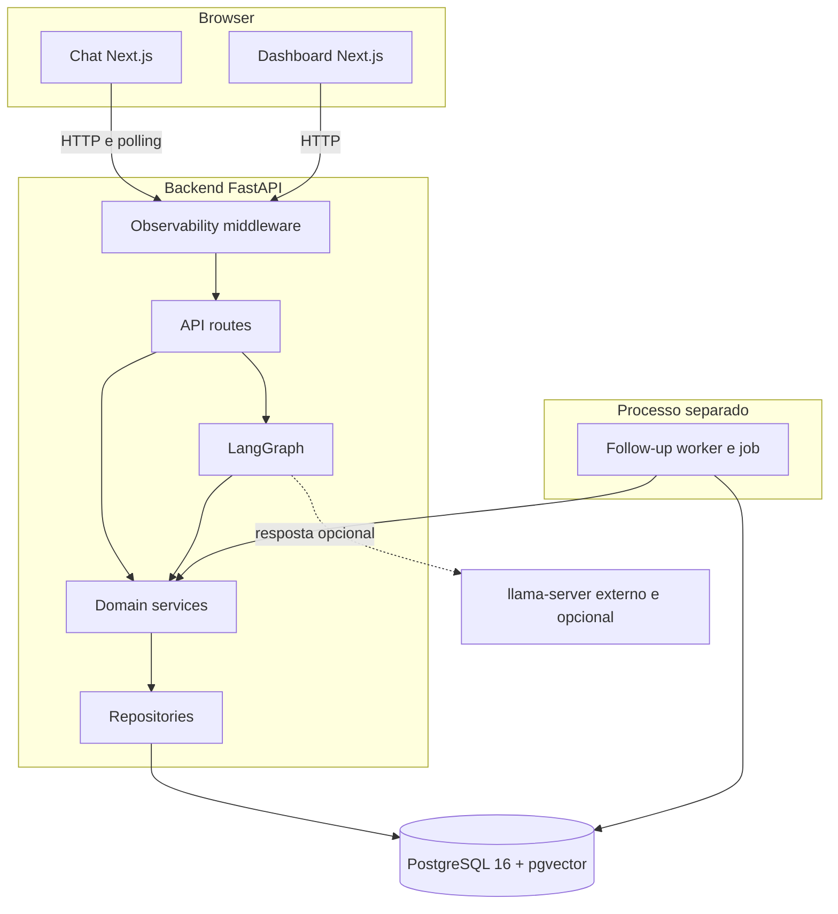
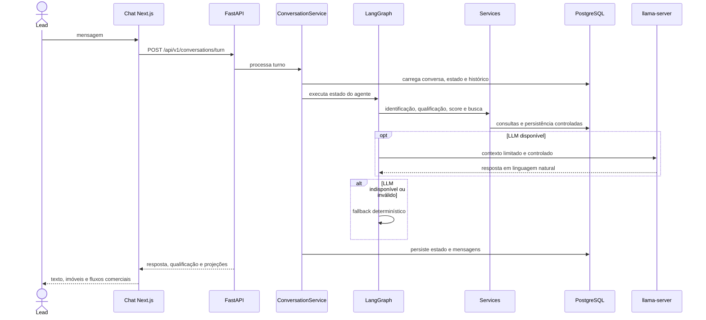
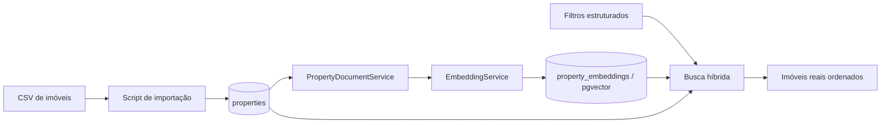
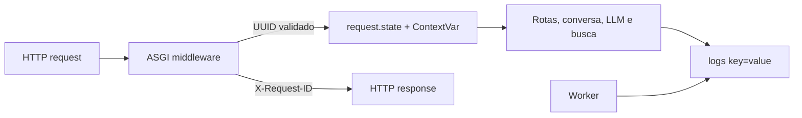

# Arquitetura — Agente SDR Imobiliário com IA

## 1. Objetivo

Este documento descreve a arquitetura implementada da POC. A solução privilegia separação de responsabilidades, regras comerciais determinísticas, persistência rastreável, Docker Compose e degradação segura quando o LLM externo não está disponível.

## 2. Visão geral implementada



### Componentes

- **Frontend Next.js:** Chat em `/` e dashboard em `/dashboard`.
- **FastAPI:** contratos REST, validação, erros padronizados e Swagger.
- **LangGraph:** orquestra o turno conversacional.
- **Services:** implementam casos de uso e regras de negócio.
- **Repositories:** concentram persistência e consultas SQLAlchemy.
- **PostgreSQL + pgvector:** armazenam domínio e embeddings.
- **LLM externo:** `llama-server` compatível com API OpenAI, opcional.
- **Follow-up worker:** processo periódico independente para entrega WEB.

Não existe uma camada genérica `tools/` no código atual. Os nodes do LangGraph chamam serviços controlados; o LLM nunca recebe acesso direto ao banco ou SQL arbitrário.

## 3. Fronteiras e responsabilidades

Fluxo HTTP convencional:

```text
Request → Route → Service → Repository → PostgreSQL
```

Fluxo conversacional:

```text
POST /conversations/turn
  → ConversationService
  → LangGraph
  → nodes determinísticos e services controlados
  → LLM opcional para formulação da resposta
  → repositories
  → PostgreSQL
```

Rotas não contêm SQL ou regras comerciais complexas. Repositories não decidem comportamento comercial. O LLM interpreta e redige; score, validação, seleção, agendamento e persistência permanecem determinísticos.

## 4. Fluxo do atendimento



O estado estruturado preserva intenção, preferências, score, classificação, imóveis apresentados, seleção e andamento do agendamento. As mensagens são persistidas, e a API pública de histórico expõe apenas roles `user` e `assistant`.

## 5. Qualificação e Lead Score

A extração comercial combina regras determinísticas com o fluxo do agente. O `LeadScoreService` calcula pontuação reproduzível a partir do estado estruturado; o LLM não calcula nem altera score ou classificação.

O roteamento busca informações ainda necessárias, evita repetir perguntas respondidas e só pesquisa imóveis quando a qualificação mínima está disponível. Negação e perguntas informativas têm guardrails para não produzir intenção ou aceite comercial indevidos.

## 6. Imóveis, embeddings e busca híbrida



O pipeline implementado vetoriza uma representação textual controlada de cada imóvel. Não é um pipeline genérico de documentos e chunks. A consulta híbrida combina similaridade vetorial com filtros SQL, e `properties` permanece a fonte factual canônica. Nenhum imóvel, preço ou atributo objetivo é inventado pelo LLM.

## 7. Seleção, agendamento e handoff

- A seleção aceita somente IDs de imóveis apresentados na conversa.
- O fluxo coleta tipo, data, horário e confirmação.
- `AppointmentService` cria `VISITA` ou `REUNIAO` de forma idempotente a partir do estado persistido.
- Visitas exigem imóvel válido; reuniões podem existir sem imóvel.
- `LeadHandoffService` gera projeção somente leitura com qualificação, imóvel e agendamento.
- `READY` conserva a semântica do serviço; `NOT_READY` é estado de projeção, não falha.

## 8. Dashboard

O dashboard é uma projeção determinística e somente leitura:

```text
GET /api/v1/dashboard/leads
GET /api/v1/dashboard/leads/{lead_id}
```

A listagem seleciona uma única conversa por lead, priorizando maior última interação, `Conversation.updated_at` e `Conversation.id`. O detalhe agrega identificação, status persistido do lead, qualificação, preferências, histórico público, imóveis apresentados, imóvel selecionado, agendamentos e handoff.

O frontend `/dashboard` trata loading, erro, retry, vazio e troca de lead. Não edita dados e não apresenta follow-ups.

## 9. Follow-up automático WEB

```mermaid
sequenceDiagram
    participant Worker as follow-up-worker
    participant DB as PostgreSQL
    participant Service as DeliveryService
    participant Chat as Chat Next.js

    loop ciclo imediato e depois a cada 30 s
        Worker->>DB: PENDING vencidos, cursor e SKIP LOCKED
        Worker->>Service: entrega item adquirido
        Service->>DB: seleciona conversa mais recente
        Service->>DB: Message assistant e Attempt WEB/SUCCESS
        Service->>DB: attempt_count e COMPLETED
        Note over Service,DB: um commit; rollback integral em falha
    end
    loop a cada 3 s
        Chat->>DB: via API, mensagens após lastMessageId
        DB-->>Chat: mensagens user/assistant
    end
```

### Concorrência e atomicidade

- Elegibilidade: `PENDING` e `scheduled_at` menor ou igual ao início do ciclo.
- Ordem/cursor: `scheduled_at ASC, id ASC`, em lotes lógicos de 100.
- Concorrência: `SELECT ... FOR UPDATE SKIP LOCKED` e revalidação sob lock.
- Sucesso atômico: Message, tentativa `WEB/SUCCESS`, contador e `COMPLETED` usam a mesma session e transação.
- Falha técnica: rollback integral, nenhum `FAILED` fictício e reavaliação somente em ciclo futuro.
- `CANCELLED` e `COMPLETED` não voltam a ser processados.

O worker escolhe a conversa mais recente pela mesma regra do dashboard: última mensagem, `updated_at` e ID. O Chat mescla mensagens por ID em ordem `created_at ASC, id ASC`, protegendo troca de sessão e requisições tardias.

`Lead.status` não é `LeadFollowUp.status`. Concluir um follow-up não encerra o lead nem implementa os estados comerciais planejados.

## 10. Observabilidade



O middleware aceita `X-Request-ID` externo apenas como UUID válido, canonicaliza-o ou gera UUID v4. Registra `request_completed` ou `request_failed` com método, rota normalizada, status e duração. O health recebe o header, mas não gera evento adicional da aplicação.

O formatter compartilhado usa allowlist estrita, tipos controlados e sanitização. Eventos internos cobrem turno conversacional, LLM/fallback, busca de imóveis e worker. Conteúdo da conversa, prompts, resposta do modelo, estado, embeddings, parâmetros SQL, headers, cookies, tokens e traceback bruto não são emitidos.

```bash
docker compose logs -f backend
docker compose logs -f follow-up-worker
```

## 11. Persistência

Entidades principais:

- `Lead`
- `Conversation`
- `Message`
- `Property`
- `PropertyEmbedding`
- `Appointment`
- `LeadFollowUp`
- `LeadFollowUpAttempt`

`Conversation.state` é JSON validado por schema e contém o estado conversacional estruturado. Alembic controla as mudanças de schema. A extensão pgvector é habilitada no PostgreSQL do projeto.

## 12. Execução em containers

| Serviço | Responsabilidade |
|---|---|
| `postgres` | PostgreSQL 16 e pgvector |
| `backend` | API FastAPI |
| `follow-up-worker` | Processamento automático periódico |
| `frontend` | Next.js |

O `llama-server` não faz parte do Compose. Em clone limpo, inicie primeiro o PostgreSQL, aplique migrations, importe imóveis, gere embeddings e só então suba o conjunto completo, conforme o [README](../README.md).

## 13. Segurança e guardrails

- O LLM não acessa SQL ou PostgreSQL diretamente.
- Dados estruturados vêm de repositories e services.
- Regras críticas são determinísticas.
- Secrets são fornecidos por ambiente e não devem ser versionados.
- Logs não registram payloads ou dados sensíveis desnecessários.
- APIs validam entradas e retornam erros padronizados.

## 14. Limitações atuais

- Não há WhatsApp, Evolution API ou e-mail.
- Não há máquina completa de estados comerciais do lead.
- O RAG cobre imóveis vetorizados, não uma base documental genérica.
- O LLM local é processo externo e opcional.
- O dashboard não edita dados e não mostra follow-ups.
- Não há autenticação, broker, fila distribuída ou alta disponibilidade.
- Não há Prometheus, Grafana, Sentry, OpenTelemetry ou tracing distribuído.

## 15. Evoluções futuras

- Integração WhatsApp via Evolution API.
- Base textual em chunks para bairros, FAQs, financiamento e políticas.
- Estados comerciais completos e política persistente de retry/backoff.
- Canal de e-mail e outros canais reais de entrega.
- Autenticação e autorização do painel do corretor.
- Avaliação formal de desempenho, qualidade do agente e operação em produção.
